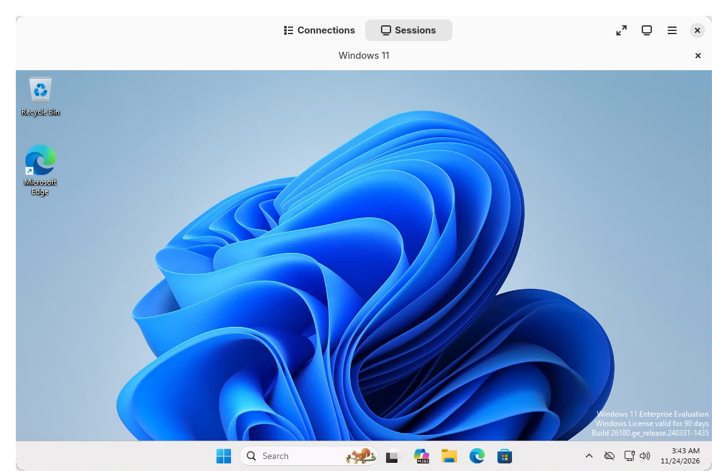
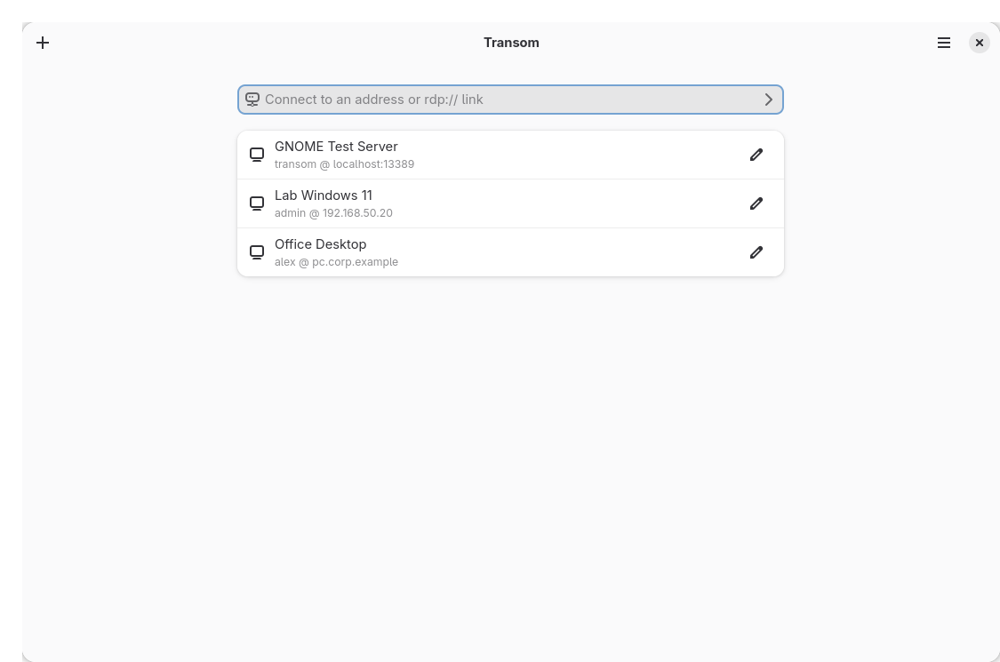

# Transom

[](COPYING)
[](LICENSE-APACHE)
[](https://github.com/jm2/transom/actions/workflows/ci.yml)

A focused, **HiDPI-correct remote desktop (RDP) client** written in Rust with **GTK 4**,
**libadwaita** and **FreeRDP 3**, and **transom-view**, the reusable GTK 4 RDP display
widget it is built on.

Transom draws remote desktops pixel for pixel on 100%, 200% and fractional-scale
displays, and treats Windows and gnome-remote-desktop as equally important servers. It
does RDP only: no plugins, no other protocols. It is a GNOME app first, and the same
GTK app runs on macOS and Windows.



> **Pre-release.** Transom works day to day against Windows and gnome-remote-desktop, and
> every feature below marked ✅ is covered by an automated check against real servers. The
> first release, v0.1.0, is being prepared; until then, build from source. The plan and
> progress log are in [PLAN.md](PLAN.md).

## Features

| Feature | Status |
|---|---|
| Pixel-exact rendering at 100%, 125%, 150%, 166.7% and 200%, through window resizes and scale changes | ✅ Checked against gnome-remote-desktop and Windows 11 |
| Dynamic resolution: the remote desktop follows the window size and scale | ✅ |
| Servers: Windows 10/11, Windows Server, gnome-remote-desktop (including remote login) | ✅ xrdp: smoke test only |
| Saved connections, quick connect, search | ✅ |
| `.rdp` files (import, export, open) and `rdp://` links | ✅ Both link formats; Linux desktop file, macOS, Windows installer |
| Certificate trust: system CAs, then trust on first use; a changed certificate blocks the connection | ✅ |
| Passwords remembered in the system keyring | ✅ Secret Service (Linux), Keychain (macOS), Credential Manager (Windows) |
| Tabs (detachable), fullscreen, multiple monitors | ✅ |
| Keyboard with system shortcuts sent to the remote; Ctrl+Alt+End for Ctrl+Alt+Del | ✅ |
| Clipboard: text, HTML, images and files, both ways | ✅ |
| Remote audio and microphone | ✅ Windows Server 2025 doesn't open the microphone ([known issue](docs/known-issues.md)) |
| RD Gateway (HTTP, RPC over HTTP, WebSocket) | ✅ |
| Kerberos single sign-on and Remote Credential Guard | ✅ Needs a FreeRDP with MS-RDPEAR (the Flatpak has it) |
| Folders as drives, printers, smart cards | ✅ |
| USB devices | ✅ Linux ([setup](docs/usb.md)); 🚧 macOS and Windows |
| Serial ports | ⚠️ Windows accepts the port but doesn't expose it ([known issue](docs/known-issues.md)) |
| H.264 graphics, zero-copy hardware decoding | ✅ Linux with VA-API and GTK's Vulkan renderer; software elsewhere |
| Screen reader labels and keyboard navigation | ✅ AT-SPI audit |
| RemoteApp windows, camera redirection, MTP/PTP devices | 🚧 Planned |
| Translations | 🚧 Planned |
| Packages: Flatpak, .deb, .rpm, Arch, macOS .dmg, Windows installer and .zip | ✅ Built by the release workflow, for x86_64 and arm64 where the platform has it |
| Linux, macOS, Windows | ✅ Linux daily; macOS (Apple silicon) and Windows 11 tested |
| Light and dark style | ✅ Automatic (libadwaita) |

Known limitations are listed in [docs/known-issues.md](docs/known-issues.md).

---

## Architecture

```text
┌──────────────────────────────────────────────────────────────┐
│ Transom (GPL-3.0-or-later)                                   │
│ libadwaita app · connections · tabs · keyring · devices UI   │
├──────────────────────────────────────────────────────────────┤
│ transom-view (Apache-2.0)                                    │
│ TransomView GTK 4 widget · input · clipboard · audio ·       │
│ tiled and dmabuf video rendering                             │
│ C API, GObject Introspection and Vala bindings (capi)        │
├──────────────────────────────┬───────────────────────────────┤
│ transom-view-core            │ transom-view-freerdp          │
│ no GTK: HiDPI geometry,      │ FreeRDP 3 engine (FFI):       │
│ engine trait, .rdp parsing,  │ channels, GFX/H.264, VA-API,  │
│ profiles, certificate trust  │ gateway, Kerberos, devices    │
└──────────────────────────────┴───────────────────────────────┘
```

The widget asks the server for a desktop in device pixels, then shows it at exactly one
device pixel per remote pixel, so text stays sharp at every scale. The design and the
decisions behind it are in [PLAN.md](PLAN.md) and [docs/decisions](docs/decisions).

`unsafe` code lives only in the FFI crates (`transom-view-freerdp`, `transom-view-capi`,
`transom-macos`) and the dmabuf import in `transom-view`; every block carries a `SAFETY:`
comment.

---

## Installation

Packages for Linux (Flatpak, `.deb`, `.rpm`, Arch), macOS (`.dmg`) and Windows (installer
and `.zip`) will be on the [Releases](https://github.com/jm2/transom/releases) page from
v0.1.0 on. Each release has a `SHA256SUMS.txt` and build provenance; verify a download
with:

```sh
sha256sum --check --ignore-missing SHA256SUMS.txt
gh attestation verify transom-amd64.deb --repo jm2/transom \
    --signer-workflow jm2/transom/.github/workflows/release.yml
```

| Platform | Package | Install |
|---|---|---|
| Linux (x86_64, aarch64) | `transom-linux-*.flatpak` | `flatpak install --user transom-linux-x86_64.flatpak` |
| Linux with glibc 2.39+: Ubuntu 24.04+, Debian 13+, Fedora 42+, Arch, openSUSE Tumbleweed (x86_64, aarch64) | `transom-linux-*.AppImage` | `chmod +x transom-linux-x86_64.AppImage`, then run it |
| Debian 13+, Ubuntu 25.10+ | `transom-amd64.deb`, `transom-arm64.deb` | `sudo apt install ./transom-amd64.deb` |
| Fedora 44+ | `transom-x86_64.rpm`, `transom-aarch64.rpm` | `sudo dnf install ./transom-x86_64.rpm` |
| Arch Linux | `transom-x86_64.pkg.tar.zst` | `sudo pacman -U transom-x86_64.pkg.tar.zst` |
| macOS 13+ (Apple silicon) | `transom-macos-aarch64.dmg` | Drag to Applications. The app isn't notarised yet: when macOS blocks the first launch, choose **Open Anyway** in System Settings → Privacy & Security |
| Windows 10/11 (x64, arm64) | `transom-windows-*-setup.exe`, `.zip` | Run the installer (it can register `.rdp` files and `rdp://` links), or unzip and run `bin\transom.exe` |

Debian 12, Ubuntu 24.04 and Ubuntu 25.04 ship a FreeRDP that is too old (Transom needs 3.15 or
newer); use the Flatpak there, or on Ubuntu the AppImage, which brings its own. The AppImage
mounts itself with FUSE (without it, run it with `--appimage-extract-and-run`), and doesn't
register `rdp://` links or `.rdp` files by itself; an AppImage integration tool can. Fedora
COPR, AUR, winget and Flathub packages are planned after v0.1.0.

---

## Building from source

Requirements everywhere: Rust 1.98 or newer, GTK 4.16, libadwaita 1.6, FreeRDP 3.15,
FFmpeg (libavcodec), and libclang for the bindings.

### Linux

Fedora:

```sh
sudo dnf install gcc clang-devel pkgconf-pkg-config freerdp-devel libwinpr-devel \
    gtk4-devel libadwaita-devel libsecret-devel libavcodec-free-devel libavutil-free-devel
```

Debian 13 / Ubuntu 25.10:

```sh
sudo apt install build-essential pkg-config clang libclang-dev libgtk-4-dev \
    libadwaita-1-dev freerdp3-dev libwinpr3-dev libsecret-1-dev libavcodec-dev libavutil-dev
```

Arch Linux:

```sh
sudo pacman -S rust clang freerdp gtk4 libadwaita libsecret ffmpeg
```

Then build:

```sh
scripts/build-linux.sh          # target/release/transom (or: cargo build --release -p transom)
scripts/build-linux.sh --run    # build, then start it
```

The script checks every dependency first and, when something is missing, prints the
command that installs it for your distribution. Distribution Rust is often older than
1.98 (Debian 13 ships 1.85); use [rustup](https://rustup.rs) there.
`scripts/install-local.sh` installs the binary, desktop file, icons and MIME type under
`~/.local`. Fedora's `libavcodec-free` has no H.264 decoder; for hardware video decoding
install RPM Fusion's `libavcodec-freeworld` and `mesa-va-drivers-freeworld`.

### Flatpak

```sh
scripts/build-linux.sh --flatpak    # dist/transom-linux-x86_64.flatpak (needs flatpak-builder)
flatpak install --user dist/transom-linux-x86_64.flatpak
```

The Flatpak builds its own FreeRDP (with Remote Credential Guard, smart cards, printers
and USB). USB redirection additionally needs
`flatpak override --user --device=all io.github.jm2.Transom`.

### AppImage

```sh
scripts/build-linux.sh --appimage   # dist/transom-linux-x86_64.AppImage
```

The AppImage bundles the libraries of the system it's built on, so build it on Debian 13
(elsewhere, in a `debian:trixie` container), as the release workflow does: the result runs
on glibc 2.39 and later. `build-aux/appimage/` has the build script, the entry point and the
list of libraries left to the host.

### macOS

```sh
brew install gtk4 libadwaita freerdp ffmpeg adwaita-icon-theme pkg-config llvm create-dmg
scripts/build-macos.sh --dmg    # dist/Transom.app and dist/Transom.dmg
scripts/build-macos.sh --run    # or build and start it, without bundling
```

### Windows

With MSYS2, rustup and PowerShell 7 installed (`pwsh` on the MSYS2 shell's `PATH`; Windows
only includes Windows PowerShell 5.1), in an MSYS2 CLANG64 shell (x64):

```bash
pacman -S mingw-w64-clang-x86_64-{toolchain,gtk4,libadwaita,freerdp,ffmpeg,adwaita-icon-theme,pkg-config,clang}
rustup target add x86_64-pc-windows-gnullvm
pwsh scripts/build-windows.ps1 -InnoSetup    # dist\transom-windows.zip and dist\transom-setup.exe
```

or in a CLANGARM64 shell (arm64):

```bash
pacman -S mingw-w64-clang-aarch64-{toolchain,gtk4,libadwaita,freerdp,ffmpeg,adwaita-icon-theme,pkg-config,clang}
rustup target add aarch64-pc-windows-gnullvm
pwsh scripts/build-windows.ps1 -InnoSetup
```

`-InnoSetup` needs Inno Setup 6 already installed (`choco install innosetup`), or
`TRANSOM_ISCC` set to the full path of `ISCC.exe`. Before building, the script checks the
MSYS2 packages, the Rust target and a linker for Rust's host (Visual Studio's C++ build
tools, or the gnullvm host toolchain), and prints the `pacman` or `rustup` command for
anything missing.

More detail, including the platform feature matrix, is in
[docs/packaging.md](docs/packaging.md).

---

## Running

```sh
transom                                           # the connection list
transom 'rdp://full%20address=s:pc.example:3389'  # connect to a link
transom office.rdp                                # open an .rdp file
transom --password-file ~/.pw pc.rdp              # read the password from a file
RUST_LOG=transom=debug transom                    # debug logging on stderr
```

With the Flatpak, run `flatpak run io.github.jm2.Transom` in place of `transom` (the same
arguments follow it). Passwords are never accepted on the command line or in environment
variables.



---

## Development

```sh
scripts/verify.sh    # rustfmt, clippy -D warnings, tests, cargo-deny, Flatpak sources
```

The platform build scripts have the same modes as Tributary's and Balun's (`--help` or
`-Help` lists them all):

```sh
scripts/build-linux.sh --fmt         # or build-macos.sh: cargo fmt
scripts/build-linux.sh --check       # cargo check, every target
scripts/build-linux.sh --clippy      # clippy -D warnings, debug and release profiles
scripts/build-linux.sh --coverage    # coverage summary (cargo-llvm-cov)
scripts/build-linux.sh --run         # build, then start Transom
scripts/build-linux.sh --deb         # dist/transom-ARCH.deb; also --rpm, --arch-pkg, --flatpak, --appimage
scripts/build-macos.sh --dmg         # dist/Transom.app and dist/Transom.dmg
```

```powershell
pwsh scripts/build-windows.ps1 -Clippy                 # also -Fmt, -Check, -Test, -Coverage, -Run
pwsh scripts/build-windows.ps1 -SkipBundle             # build transom.exe only
pwsh scripts/build-windows.ps1 -InnoSetup -SkipBundle  # installer from the existing bundle
```

Changes reach `main` only through pull requests; CI (Linux on x86_64 and aarch64,
Flatpak, macOS, Windows on x64 and arm64) must pass, and CodeRabbit reviews every PR.

The interop checks run against throwaway servers on this machine, never real accounts:

| Servers | Started by |
|---|---|
| gnome-remote-desktop (headless and GDM remote login), xrdp, an MIT KDC | `scripts/test-servers.sh up` (rootless containers) |
| Windows 11 and Windows Server 2025, an AD domain, an RD Gateway | `scripts/winvm.sh` and `scripts/ad-setup.sh` (rootless QEMU) |

Each `scripts/*-check.sh` covers one area against them: rendering (`view-check.sh`),
input, clipboard, audio, multiple monitors, latency, remote login, gateway, Kerberos and
Active Directory, devices, USB, hardware video decoding and accessibility. Pick the server
with `TARGET=grd|win11|server`.

---

## Project structure

| Path | Contents |
|---|---|
| `crates/transom-view-core` | Pure Rust, no GTK: HiDPI geometry, engine trait, `.rdp` and `rdp://` parsing, profiles, certificate trust, devices |
| `crates/transom-view-freerdp` | FreeRDP 3 engine (FFI), H.264 and VA-API decoding |
| `crates/transom-view` | The `TransomView` GTK 4 widget |
| `crates/transom-view-capi` | C ABI, GObject type, GIR and VAPI for other languages |
| `crates/transom-macos` | macOS glue (`rdp://` Apple Events) |
| `crates/transom` | The libadwaita application |
| `data/` | Desktop file, metainfo, MIME type, icons, screenshots |
| `build-aux/` | Flatpak, RPM, Arch and Inno Setup packaging |
| `scripts/` | Build, packaging and test scripts |
| `tests/servers/` | Test server containers and Windows VM setup |
| `docs/` | Decisions (ADRs), packaging, USB, known issues |

---

## License

- The **transom-view** libraries (`transom-view-core`, `transom-view-freerdp`,
  `transom-view`, `transom-view-capi`) are licensed under the Apache License, Version 2.0
  ([LICENSE-APACHE](LICENSE-APACHE)).
- The **Transom** application (`crates/transom`, `crates/transom-macos`, `data/`) is
  licensed under the GNU General Public License, version 3 or (at your option) any later
  version ([COPYING](COPYING)).
